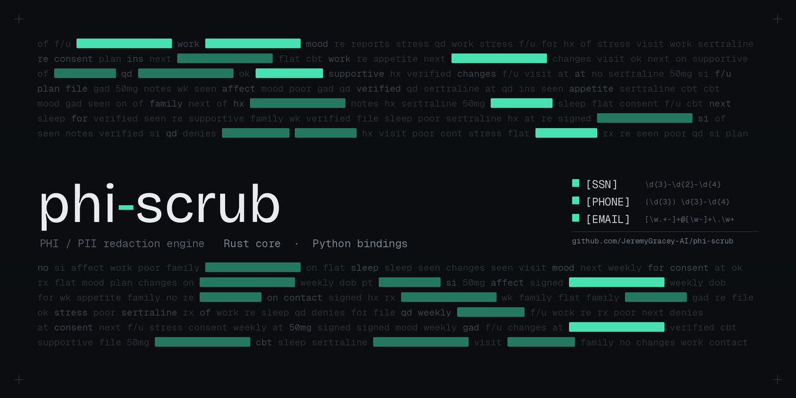

# phi-scrub

[](https://crates.io/crates/phi-scrub)
[](https://pypi.org/project/phi-scrub/)
[](https://github.com/JeremyGracey-AI/phi-scrub/actions/workflows/ci.yml)
[](LICENSE)

HIPAA-oriented PHI/PII redaction for telehealth and behavioral-health notes. Rust engine, Python package, single-binary CLI.

## Install

**Rust** — [crates.io/crates/phi-scrub](https://crates.io/crates/phi-scrub)
```bash
cargo add phi-scrub
```

**Python** — [pypi.org/project/phi-scrub](https://pypi.org/project/phi-scrub/)
```bash
uv add phi-scrub
```

**CLI**
```bash
cargo install phi-scrub
echo "SSN 123-45-6789, call 808-555-0100" | phi-scrub
# SSN [SSN], call [PHONE]
```

`main` is ahead of the published 0.1.0. Reversible redaction, the MRN, NPI, DEA, and MBI detectors, and the MCP server arrive in 0.2.0. Until then, install from the repository:

```bash
cargo install --git https://github.com/JeremyGracey-AI/phi-scrub
```

## Use

```rust
use phi_scrub::Scrubber;
let out = Scrubber::new().redact("mail me@example.com");
// "mail [EMAIL]"
```

```python
import phi_scrub
s = phi_scrub.Scrubber()
s.redact("SSN 123-45-6789")   # 'SSN [SSN]'
s.detect("call (808) 555-0100")  # [Finding(start=5, end=19, category='phone')]
```

## Reversible redaction

For LLM workflows: redact, send the tokens to the model, then restore its reply. The token map holds the original values, so keep it local and never send it to the model.

```rust
use phi_scrub::{restore, Scrubber};

let r = Scrubber::new().redact_reversible("SSN 123-45-6789, mail me@example.com");
// r.text == "SSN [SSN_1], mail [EMAIL_1]"
let reply = "Confirmed [EMAIL_1] for the patient."; // what the model sent back
let restored = restore(reply, &r.map);
// "Confirmed me@example.com for the patient."
```

```python
import phi_scrub

s = phi_scrub.Scrubber()
text, token_map = s.redact_reversible("SSN 123-45-6789, mail me@example.com")
# text == 'SSN [SSN_1], mail [EMAIL_1]'
phi_scrub.restore("Confirmed [EMAIL_1] for the patient.", token_map)
# 'Confirmed me@example.com for the patient.'
```

- The same value gets the same token within one call.
- A token that already appears in the input is never issued, so the round trip is byte-exact.
- `restore` leaves tokens it doesn't know alone.
- Token numbers restart on every call, so `[SSN_1]` from two calls can stand for two different values. Keep each map with the text it came from. A map that carries across the turns of a chat is not built yet.

## MCP server

`phi-scrub mcp` serves three tools over stdio. It is opt-in, behind the `mcp` feature, and needs Rust 1.88 or newer.

```bash
cargo install --git https://github.com/JeremyGracey-AI/phi-scrub --features mcp
```

```json
{ "mcpServers": { "phi-scrub": { "command": "phi-scrub", "args": ["mcp"] } } }
```

| Tool | Arguments | Returns |
|---|---|---|
| `detect` | `text` | `findings`: byte offsets and categories, never the matched text |
| `redact` | `text` | `text` with numbered tokens, plus `token_map` |
| `restore` | `text`, `token_map` | `text` with the original values back |

The server stores nothing. `token_map` holds the original values, so handle it like the PHI it is.

**Who calls the tools matters.** A model that calls `redact` itself has already read the raw text, and it reads the `token_map` in the result. Redaction protects a model only when your own code, or a trusted local agent, calls `redact` first and passes on just the redacted text.

## Detectors

| Token | Detects | Check |
|---|---|---|
| `[SSN]` | `\d{3}-\d{2}-\d{4}` | format |
| `[MRN]` | the value after an `MRN` or `medical record number` label, such as `MRN: …`, `MRN #…`, or `Medical Record No. …` | label, plus at least one digit |
| `[NPI]` | ten digits starting with 1 or 2 | Luhn with the `80840` prefix |
| `[DEA]` | two letters and seven digits | DEA check digit |
| `[MBI]` | eleven characters, dashes optional | CMS position layout |
| `[PHONE]` | `(\d{3}) \d{3}-\d{4}` and `\d{3}-\d{3}-\d{4}` variants | format |
| `[EMAIL]` | RFC-ish local@domain | format |

Findings never overlap. When two detectors match the same text, the row listed first wins: a labeled MRN beats an NPI, and a valid NPI beats a phone number. Matches that only partly overlap merge into one finding, so no detected text is left in the clear.

More detectors (names, dates, addresses) on the roadmap.

## Develop

```bash
cargo fmt --check && cargo clippy --all-targets -- -D warnings && cargo test
uv sync && uv run maturin develop --release && uv run pytest python/tests -q
```

## License

Apache-2.0 — see [LICENSE](LICENSE).
